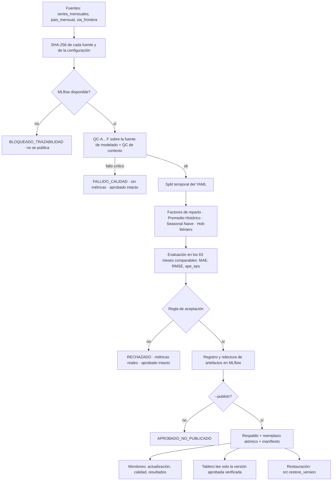

# Observatorio de Inteligencia Turística — Laboratorio 11: MLOps y pipeline reproducible

**Universidad del Valle de Guatemala — Facultad de Ingeniería — Departamento de Ciencias de la Computación**
**CC3066 Data Science | 2026**
**Memoria técnica** (actualizada el 2026-11-02 con resultados verificados; reemplaza el avance del 2026-10-29)

> Todas las cifras de esta memoria provienen de ejecuciones reales registradas en `evidencias/lab11/` (ver [docs/guia_evidencias_lab11.md](docs/guia_evidencias_lab11.md)). Los identificadores `run_20261029_*` del avance anterior se conservan solo como **históricos**: sus artefactos no están disponibles en el entorno verificado y no se usan como prueba. El estado inciso por inciso está en [docs/auditoria_final_lab11.md](docs/auditoria_final_lab11.md).

---

## 1. Alcance del flujo (Ejercicio 1)

### 1.1 Especificación de la estimación y fuentes

- **Variable estimada:** ingreso mensual de viajeros a Guatemala (`viajeros`) para la serie `Total` y siete subseries: `Via_Aérea`, `Via_Terrestre`, `Via_Marítima`, `Tipo_Turista`, `Tipo_Excursionista`, `Tipo_Cruceristas`, `Tipo_Viajero`.
- **Unidad:** viajeros/mes (no negativa). **Agregación:** mensual, fecha `YYYY-MM-01`.
- **Fuentes y uso real en el código:**

| Archivo | Columnas | Uso |
|---|---|---|
| `data/series_mensuales.csv` | `serie`, `fecha`, `viajeros` | Modelado y QC-A…F (2009-01 a 2026-06, 8 series × 210 meses) |
| `data/pais_mensual.csv` | `fecha`, `pais`, `region`, `viajeros` | Contexto: QC de unicidad y valores (no bloqueante) y monitoreo; no alimenta el modelo |
| `data/via_frontera.csv` | `fecha`, `via`, `frontera`, `viajeros` | Contexto: QC de unicidad (no bloqueante) y monitoreo; no alimenta el modelo |

- **Periodos (`config/pipeline_config.yaml`):** ajuste 2009-01 a 2021-03 (147 meses); evaluación por *backtest* de origen fijo 2021-04 a 2026-06 (63 meses). `excluded_evaluation_periods` está vacío: **enero y febrero de 2026 sí se evalúan** porque tienen observación en la fuente. La memoria anterior afirmaba que se excluían; eso no correspondía al código.
- **Limitaciones de enero–febrero de 2026 (enunciado 5.1 y 5.5):** ambos meses tienen valor observado en la fuente mensual y coinciden en las tres fuentes institucionales (319,106 y 254,048 viajeros; `evidencias/lab11/evaluacion/sensibilidad_ene_feb_2026.json`), por eso se evalúan. El backtest **no reproduce** la situación real de esos meses: (1) se estiman desde el origen fijo 2021-03 (horizonte de 58–59 meses), no con la información disponible a inicios de 2026; (2) la fuente no documenta si las cifras son preliminares o revisadas, así que su comparabilidad institucional no está certificada; (3) 2026 es un año parcial (hasta junio). Sensibilidad sin cambiar la regla: sin ene–feb 2026 el MAE del modelo activo pasa de 80,365.74 (N=63) a 81,388.83 (N=61) y el del baseline de 235,730.91 a 236,852.07; la decisión no cambia. Si la institución los declarara no comparables, la exclusión se agrega al YAML con su motivo **antes** de evaluar una nueva versión.
- **Modelo activo:** Promedio Histórico Mensual (promedio por mes calendario en el periodo de ajuste). Referencias: Seasonal Naive lag 12 (baseline de aceptación) y Holt-Winters aditivo (referencia, no activo).
- **Factores de reparto** (proporción de cada subserie sobre el Total, calculada solo en el periodo de ajuste; valores del run `run_20261102_001410_ce7eea`): `Tipo_Turista` 0.740787, `Via_Terrestre` 0.590367, `Via_Aérea` 0.375932, `Tipo_Excursionista` 0.162625, `Tipo_Viajero` 0.065763, `Via_Marítima` 0.033701, `Tipo_Cruceristas` 0.030825.
- **Archivo que usa el tablero:** `data/estimaciones_aprobadas.csv` y su manifiesto `data/estimaciones_aprobadas.manifest.json` (SHA-256, `run_id`, métricas y periodo evaluado).

### 1.2 Diagrama del pipeline



---

## 2. Pipeline reproducible y configuración (Ejercicio 2)

- **Orquestación:** `src/pipeline.py` (`TourismMLOpsPipeline`), entrada `pipeline.py`. Etapas: verificación de MLflow → lectura y huellas → QC → split → modelos y factores → evaluación → candidato, integridad y aceptación → registro verificado en MLflow → publicación atómica (opcional) → monitoreo y auditoría.
- **Comando:** exactamente una bandera es obligatoria.

```bash
python pipeline.py --config config/pipeline_config.yaml --publish     # publica si se aprueba
python pipeline.py --config config/pipeline_config.yaml --no-publish  # dry-run
```

- **Códigos de salida:** 0 aprobado, 1 rechazado, 2 fallo, 3 bloqueado por trazabilidad.
- **Configuración:** rutas, periodos, exclusiones, modelo activo, hiperparámetros de Holt-Winters, umbrales de aceptación y de monitoreo, semilla 42, estrategia MLflow y reintentos (todo en el YAML).
- **Dependencias:** `requirements.txt` (directas, exactas) + `requirements.lock` (transitivas), Python 3.12.10 en la imagen.

---

## 3. Controles automáticos de calidad (Ejercicio 3)

| ID | Qué verifica (código real) | Advertencia | Detiene |
|---|---|---|---|
| QC-A | Columnas `serie`, `fecha`, `viajeros` y tipos convertibles | — | Columna ausente o tipo incompatible |
| QC-B | Fechas válidas, día 1, sin huecos en la serie objetivo y ventana `train_start`–`eval_end` cubierta | — | Fecha inválida, día ≠ 1, hueco o ventana incompleta (no se imputa cero) |
| QC-C | Unicidad de (`serie`, `fecha`) | — | Cualquier duplicado |
| QC-D | Nulos en columnas indispensables | — | Nulo en `serie`/`fecha`/`viajeros` |
| QC-E | Valores finitos y no negativos (el cero es válido) y denominador del factor de reparto ≠ 0 | — | NaN, infinito, negativo o suma del Total en ajuste = 0 |
| QC-F | Total ≈ Aérea + Terrestre + Marítima (tolerancia 2 %) | Si `methodological_fail_on_discrepancy: false` | Discrepancia material o insumos faltantes (`NO_VERIFICABLE`) |
| Contexto | Unicidad y valores de `pais_mensual` y `via_frontera` | Fallos se degradan a WARNING (`context_sources_critical: false`) | Solo si se configura como crítico |

**Denominador cero (3.1 e).** QC-E verifica también el denominador del factor de reparto (suma del Total en el periodo de ajuste, `src/quality_checks.py::_check_values_and_repartition_denominator`). Si es cero, la corrida termina `FALLIDO_CALIDAD` antes del modelado (prueba `tests/test_lab11_verificacion.py::DenominadorCeroEnQC`, que falla sin el cambio). `calculate_repartition_factors` conserva su propia validación como segunda barrera.

---

## 4. Trazabilidad con MLflow (Ejercicio 4)

### 4.1 Configuración

- **Local:** `sqlite:///mlflow_store/mlflow.db`, artefactos en `mlflow_store/artifacts`.
- **Docker Compose:** servidor `mlflow` (`--serve-artifacts`), SQLite y artefactos en el volumen `observatorio_turismo_mlflow_store`. El pipeline usa `MLFLOW_TRACKING_URI=http://mlflow:5000`.
- **Por run:** etiquetas de estado, commit (`git rev-parse HEAD` o declarado con `GIT_COMMIT` en contenedor), huellas SHA-256 de fuentes, configuración y código, semilla, split, factores, modelo, QC, aceptación, métricas del modelo y de los baselines en los mismos meses, monitoreo, auditoría, estimaciones candidatas y manifiesto. Los artefactos se releen antes de publicar.

### 4.2 Reproducibilidad (resultado real)

Dos ejecuciones `--no-publish` dentro de Docker, misma imagen, configuración y datos, registradas en el servidor MLflow de Compose:

| Run | MLflow ID | Estado |
|---|---|---|
| `run_20261102_001410_ce7eea` | `7787c39f59d64cf69394bde8de3ea709` | APROBADO_NO_PUBLICADO |
| `run_20261102_001413_338a6e` | `575d18e094f245f1bf51697e3cd11381` | APROBADO_NO_PUBLICADO |

Comparación (`reports/reproducibilidad_lab11.json`): 8 series × 63 meses con `np.allclose(atol=1e-6, rtol=0)`; diferencia máxima **0.0**; huellas de configuración (`d12e42c6…`), código (`54c04097…`) y las tres fuentes idénticas; 25 métricas idénticas; estado **REPRODUCIBLE**. Se ignoraron solo campos volátiles (`run_id`, tiempos, `pipeline.duration_seconds` y las columnas `run_id`/`fecha_generacion` del CSV candidato, cuyo hash se recalculó sin ellas y coincide).

**Holt-Winters no es reproducible entre entornos.** En el contenedor Linux (statsmodels 0.15.0) su MAE fue 302,827.47 en todas las corridas; la etapa previa registró 178,765.59 en Windows. El modelo activo (promedio histórico) da MAE 80,365.74 en todos los entornos observados. Holt-Winters no es el modelo activo.

### 4.3 Ejecuciones fallidas y rechazadas

Las corridas fallidas quedan en MLflow con su estado (`FALLIDO_CALIDAD`, `FALLIDO`; `BLOQUEADO_TRAZABILIDAD` queda solo en la auditoría local porque MLflow no está disponible) y **sin métricas de evaluación inventadas**. Ver §7.2 para los identificadores reales. El rechazo por desempeño se prueba en `tests/test_mlops_integracion.py::test_corrida_rechazada_registra_metricas_reales_sin_publicar` (tolerancia forzada) y en `tests/test_mlops_pipeline.py::test_acceptance_rule_rejection_on_high_mae`.

---

## 5. Evaluación temporal y regla de aceptación (Ejercicio 5)

### 5.1 Protocolo

Backtest de origen fijo: se ajusta con 2009-01–2021-03 y se estiman los 63 meses 2021-04–2026-06 sin reajuste. `build_evaluation_mask` solo usa meses con observación finita; no hubo exclusiones. Prueba de no fuga: `tests/test_lab11_verificacion.py::SinFugaTemporal` (alterar ×10 los meses evaluados no cambia ningún parámetro, factor ni predicción).

### 5.2 Métricas

MAE y RMSE en viajeros/mes. La métrica relativa es `ape_eps_pct = mean(|e| / (|y| + 1)) × 100`; **no es el MAPE convencional** (el avance anterior la llamaba MAPE).

### 5.3 Resultados en los mismos 63 meses (run `run_20261102_001410_ce7eea`)

| Procedimiento | MAE | RMSE | ape_eps % | N |
|---|---:|---:|---:|---:|
| Promedio Histórico Mensual (activo) | 80,365.74 | 94,175.26 | 38.67 | 63 |
| Seasonal Naive lag 12 (baseline) | 235,730.91 | 253,203.39 | 83.86 | 63 |
| Holt-Winters aditivo (referencia) | 302,827.47 | 327,720.16 | 103.99 | 63 |

El Seasonal Naive de origen fijo repite recursivamente el último año de ajuste (abr 2020–mar 2021, con la caída por COVID-19), por eso su error a horizonte largo es alto.

**Backtest complementario de cortes múltiples** (8 orígenes, horizonte 12 meses, mismos meses para todos; `evidencias/lab11/evaluacion/backtest_cortes_multiples.json`): MAE promedio 100,571.55 (activo), 75,372.56 (Seasonal Naive) y 82,724.43 (Holt-Winters). **A horizonte de 12 meses el baseline supera al modelo activo en 6 de 8 cortes.** No se cambió el modelo ni la regla tras ver este resultado; se documenta como riesgo (ver auditoría).

### 5.4 Regla de aceptación activa en el código

Un candidato se aprueba solo si: (1) todos los QC críticos pasan; (2) la salida es íntegra (todas las series, sin nulos, finitos, no negativos tras recortar a ≥0); (3) MAE ≤ 150,000 y (4) RMSE ≤ 180,000 (`enforce_rmse_tolerance: true`). Superar al baseline **no** es obligatorio (`require_better_than_baseline: false`); se registra `acceptance.beats_baseline`. Los umbrales se fijaron antes de la evaluación (comentario en el YAML) y no se ajustaron.

---

## 6. Integración con el tablero (Ejercicio 6)

- `data_logic.cargar_version_aprobada` lee el CSV vigente y su manifiesto; estados `ok`, `ausente`, `inaccesible`, `invalida`. Las métricas solo se muestran si el SHA-256 y el `run_id` del manifiesto coinciden con el CSV. Sin caché.
- Pestaña **Modelos**: MAE de la versión aprobada, periodo evaluado, fecha de generación (no último mes de datos), versión del procedimiento (`run_id` en la ayuda) y expansor de límites (2026 parcial, reparto proporcional, recuperación pospandemia, sin causalidad).
- Gráfico V08: Observado (azul), Estimación aprobada (verde) y banco Lab 10 (discontinuas).
- Evidencia: `evidencias/lab11/dashboard/` (versión vigente, móvil, restaurada y sin versión aprobada). Cambiar filtros no creó runs (24 antes y después) ni archivos de salida.
- Corrección de esta etapa: los valores de las tarjetas de métricas se truncaban con «…» en escritorio; se ajustó `styles.css`.

---

## 7. Monitoreo, fallos y recuperación (Ejercicio 7)

### 7.1 Monitoreo (`src/monitoring.py`)

1. **Actualización:** última observación de cada fuente frente a `expected_coverage_end` (2026-06) y última estimación frente a `eval_end`.
2. **Calidad:** cobertura, nulos y duplicados con umbrales, comparados con la ejecución previa.
3. **Resultados:** no finitos, negativos y variación intermensual > 50 % (alerta de revisión, no pérdida de precisión).

Demostración real (copia temporal): línea base 0 alertas; serie truncada a 2026-04 → alerta de actualización; 25 filas duplicadas → alerta de calidad (tasa 0.0147 > 0.0); Total 2024-07 ×3 → alerta de revisión (+236.8 % / −66.0 %).

### 7.2 Prueba controlada (`scripts/lab11/fallos_controlados.py`, registrada en el experimento `Observatorio_Turismo_Guatemala_pruebas_controladas` del servidor Docker)

Versión aprobada inicial A: `run_20261101_222030_d65c3b`, SHA-256 `d5795b8c…`.

| Falla inyectada | Estado | Detección | Aprobado intacto |
|---|---|---|---|
| Columna `viajeros` ausente | FALLIDO_CALIDAD | QC-A FAILED, QC-F NO_VERIFICABLE | Sí |
| Clave (`serie`,`fecha`) duplicada | FALLIDO_CALIDAD | QC-C FAILED, QC-F FAILED | Sí |
| Conteo negativo (Total 2015-03) | FALLIDO_CALIDAD | QC-E FAILED, QC-F FAILED | Sí |
| Denominador cero (Train en 0) | FALLIDO_CALIDAD | QC-E FAILED (suma del Total en ajuste = 0) | Sí |
| Error de escritura (`os.replace`) | FALLIDO | etapa «Publicación atómica», sin temporales | Sí |
| MLflow inaccesible | BLOQUEADO_TRAZABILIDAD | verificación previa | Sí |
| Artefacto no persistido | FALLIDO | «Registro verificado en MLflow» | Sí |

Tras corregir los datos, la recuperación publicó la versión B (`run_20261102_013359_237d8b`, `59c2176b…`). La restauración del respaldo de A devolvió exactamente `d5795b8c…` con su manifiesto y el tablero leyó `run_20261101_222030_d65c3b` con metadatos verificados.

**Defecto encontrado y corregido.** `mlflow.set_tracking_uri()` escribe `MLFLOW_TRACKING_URI` en el entorno y esa variable tiene prioridad sobre el YAML: en un mismo proceso, una segunda corrida ignoraba su configuración (un servidor caído no bloqueaba la publicación). `TourismMLOpsPipeline.run()` ahora restituye las variables al terminar; prueba de regresión `AislamientoTrackingURI`.

### 7.3 Respaldo y restauración

Cada publicación respalda CSV y manifiesto en `data/backup_aprobadas/`. Restauración con `python -m src.restore_version --list` / `--backup <archivo> --reason <motivo>`: valida ruta, esquema, estado, `run_id` y SHA-256, respalda la vigente (`_prerestauracion`) y reemplaza atómicamente; auditoría en `logs/restore_audit.jsonl`. Verificado en Docker (`evidencias/lab11/recuperacion/restauracion_docker.log`).

---

## 8. Docker y Docker Compose (Ejercicio 8)

- Imagen `observatorio-turismo:lab11` (`python:3.12.10-slim`), usuario `app` (uid 1000), `.dockerignore` como lista blanca: la imagen no contiene CSV, `.db`, `.env`, claves ni `.git` (inspección en el log).
- Servicios: `mlflow` (healthcheck `/health`), `dashboard` (lee `./data` en solo lectura) y `pipeline` (perfil `tools`). Puertos solo en 127.0.0.1.
- Verificado desde una copia limpia (`git clone` del commit `bced471`, sin archivos locales añadidos; inciso 8.4): build, `up -d --wait`, `ps`, HTTP 200 en tablero y MLflow, dos dry-run reproducibles (`run_20261102_013222_08ad93`, `run_20261102_013225_d69796`; diferencia máxima 0.0), una publicación (`run_20261102_013228_107c2c`), `down` y `up` sin `-v` con los mismos 16 runs. El `code.sha256` de esas corridas (`54c04097…`) es el mismo de las corridas hechas antes del commit.
- **Defecto corregido:** `--allowed-hosts` fijaba el puerto 5000; con `MLFLOW_PORT` distinto la UI y la API respondían «Invalid Host header». Se agregó `${MLFLOW_PORT:-5000}` (prueba `ComposePuertoMLflow`).

---

## 9. Pruebas automatizadas

`python -B -m unittest discover -s tests -v`: **100 pruebas, 99 PASS, 0 FAIL, 1 SKIP** (la prueba Docker, que requiere `RUN_DOCKER_TESTS=1`). Con `RUN_DOCKER_TESTS=1 MLFLOW_PORT=5001` se ejecuta también la prueba contra Compose: 100 PASS (ver `evidencias/lab11/tests_unitarios_docker.txt`).

| Archivo | Pruebas |
|---|---:|
| `tests/test_lab10.py` | 27 |
| `tests/test_quality_checks.py` | 18 |
| `tests/test_mlops_pipeline.py` | 16 |
| `tests/test_mlops_integracion.py` | 28 |
| `tests/test_lab11_verificacion.py` (nuevo) | 10 |
