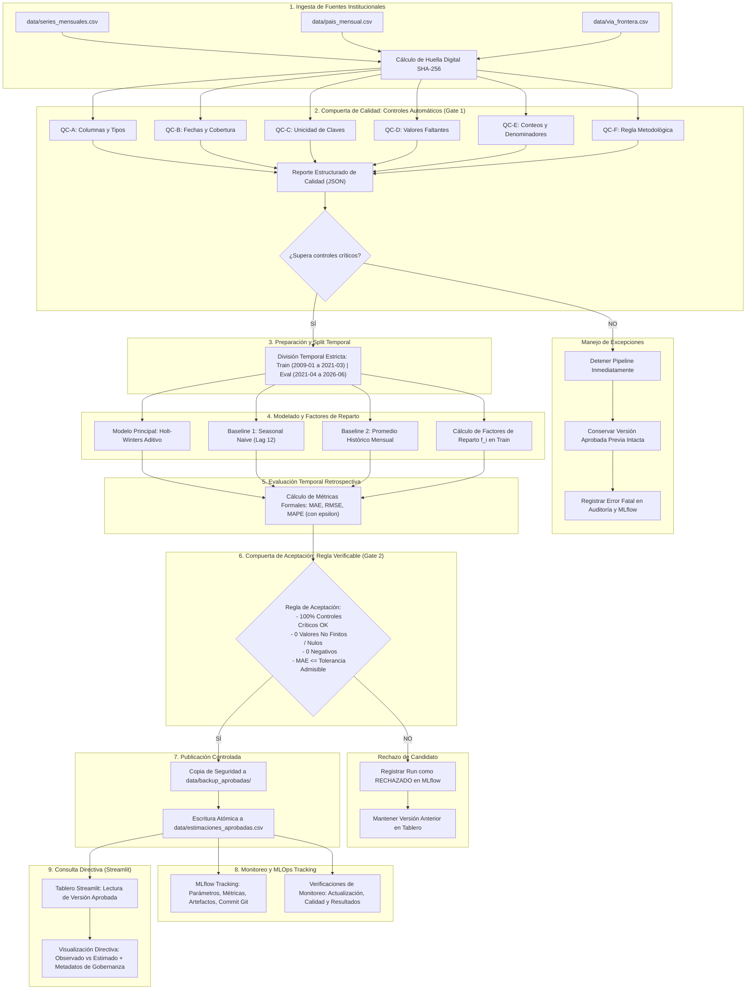

# Observatorio de Inteligencia Turística — Laboratorio 11: MLOps y Pipeline Reproducible

**Facultad de Ingeniería — Departamento de Ciencias de la Computación**  
**CC3066 – Data Science | Ciclo 2026**  
**Entrega:** Avance de Laboratorio 11 (Alcance, Diagrama, Pipeline Inicial, Controles de Calidad Funcionales y Trazabilidad MLOps)

---

## 1. Definición del Alcance del Flujo (Ejercicio 1)

### 1.1. Especificación Técnica de la Estimación y Fuentes

* **Variable que se estima:** Conteo de ingreso mensual de viajeros a Guatemala (`viajeros`), estructurado en la serie principal nacional (`Total`) y desglosado metodológicamente en siete subseries sectoriales:
  * Por vía de ingreso: Vía Aérea (`Via_Aérea`), Vía Terrestre (`Via_Terrestre`), Vía Marítima (`Via_Marítima`).
  * Por categoría migratoria: Turistas (`Tipo_Turista`), Excursionistas (`Tipo_Excursionista`), Cruceristas (`Tipo_Cruceristas`), Viajeros en tránsito y comercio fronterizo (`Tipo_Viajero`).
* **Unidad de medida:** Conteo entero de viajeros por mes (`viajeros/mes`). Físicamente no acotado superiormente pero estrictamente no negativo ($\ge 0$).
* **Nivel de agregación:** Temporal mensual regularizado (`YYYY-MM-01`, primer día de cada mes).
* **Fuentes institucionales y columnas utilizadas:**
  1. `data/series_mensuales.csv`: Serie primaria histórica. Columnas: `serie` (string), `fecha` (ISO-8601 `YYYY-MM-01`), `viajeros` (float/int). Cobertura: 2009-01 a 2026-06 (210 meses continuos, 1,680 registros).
  2. `data/pais_mensual.csv`: Desagregación geográfica de procedencia. Columnas: `fecha`, `pais`, `region`, `viajeros`.
  3. `data/via_frontera.csv`: Desagregación por puesto aduanal y vía. Columnas: `fecha`, `via`, `frontera`, `viajeros`.
* **Períodos de ajuste y evaluación:**
  * **Período de ajuste / entrenamiento ($T_{\text{train}}$):** Enero 2009 a Marzo 2021 (147 meses). Comprende la serie histórica base y el shock inicial de la pandemia COVID-19.
  * **Período de evaluación / backtesting ($T_{\text{eval}}$):** Abril 2021 a Junio 2026 (63 meses coincidentes con los datos observados de validación).
  * **Período reciente con limitaciones de comparación:** Enero y Febrero de 2026 (y datos del año parcial 2026), debido al cambio en la consolidación institucional y falta de cierres definitivos anuales.
* **Parámetros, supuestos y Factores de Reparto ($f_i$):**
  * **Principio de causalidad temporal:** Todo parámetro y factor de reparto se calcula **exclusivamente con información previa a la fecha evaluada** ($t \le t_{\text{corte}}$). Queda estrictamente prohibida cualquier fuga de información (*data leakage*) del futuro.
  * **Factor de Reparto Histórico ($f_i$):** Representa la proporción esperada de cada serie secundaria $i$ respecto al flujo migratorio total del país. Se estima de forma transparente y determinística como:
    $$f_i = \frac{\sum_{t \in T_{\text{train}}} \text{viajeros}_{i, t}}{\sum_{t \in T_{\text{train}}} \text{viajeros}_{\text{Total}, t}}$$
    *Valores calculados en el período de ajuste:*
    * `Tipo_Turista`: $0.7408$ (74.08% del flujo total)
    * `Via_Terrestre`: $0.5904$ (59.04% de las entradas)
    * `Via_Aérea`: $0.3759$ (37.59% de las entradas)
    * `Tipo_Excursionista`: $0.1626$ (16.26%)
    * `Tipo_Viajero`: $0.0658$ (6.58%)
    * `Via_Marítima`: $0.0337$ (3.37%)
    * `Tipo_Cruceristas`: $0.0308$ (3.08%)
* **Archivo de resultados que utiliza el tablero:**
  * Archivo aprobado: `data/estimaciones_aprobadas.csv`.
  * Esquema de gobernanza: `destino`, `serie`, `modelo`, `fecha`, `prediccion`, `unidad_medida`, `run_id`, `fecha_generacion`, `version_procedimiento`, `estado_aprobacion`.

---

### 1.2. Diagrama Arquitectónico del Pipeline MLOps

El flujo implementa una separación estricta entre el procesamiento por lotes (*batch pipeline*) y la interfaz de usuario (*Streamlit*), garantizando que las consultas o filtros interactivos nunca reentrenen modelos. Cuenta con dos compuertas de seguridad (*Quality Gate* y *Acceptance Gate*):



---

## 2. Pipeline Reproducible y Configuración (Ejercicio 2)

### 2.1. Automatización Integral
El flujo está implementado en `src/pipeline.py` y se orquesta de forma secuencial y atómica:
1. **Lectura y Hash:** Lee los datos y genera su huella digital SHA-256 para verificar que las fuentes no han sido alteradas externamente.
2. **Validación (Gate 1):** Aplica la suite de 6 controles de calidad. Si detecta anomalías críticas, cancela la ejecución antes de tocar ningún archivo de producción.
3. **Preparación:** Normaliza tipos de datos y realiza la separación temporal estricta entre períodos de ajuste y evaluación.
4. **Ajuste y Parámetros:** Ajusta los modelos y calcula los factores de reparto histórico $f_i$.
5. **Evaluación Retrospectiva:** Oculta los meses observados de 2021-2026 y mide el error predictivo (MAE, RMSE, MAPE).
6. **Regla de Aceptación (Gate 2):** Verifica si el candidato cumple con los estándares cuantitativos y de integridad.
7. **Publicación y Backup:** Si la versión es aprobada, respalda la versión anterior en `data/backup_aprobadas/` y escribe atómicamente `data/estimaciones_aprobadas.csv`.
8. **Monitoreo:** Ejecuta verificaciones de alerta sobre deriva de cobertura y variaciones anómalas.
9. **Trazabilidad MLflow:** Registra el experimento, run ID, commit de git, hiperparámetros, métricas y artefactos.

### 2.2. Comando Documentado de Ejecución
El pipeline no depende del estado de una sesión de Streamlit ni de variables en memoria:
```bash
# Ejecución completa estándar (con validación, evaluación y publicación controlada)
python pipeline.py --config config/pipeline_config.yaml --publish

# Modo evaluación sin publicación (dry-run para auditoría o pruebas)
python pipeline.py --config config/pipeline_config.yaml --no-publish
```

### 2.3. Archivo de Configuración (`config/pipeline_config.yaml`)
El archivo de configuración centraliza:
* Rutas de lectura y publicación.
* Períodos temporales (`train_start`, `train_end`, `eval_start`, `eval_end`).
* Modelo activo (`historical_mean`, `holt_winters`, `seasonal_naive`).
* Hiperparámetros de suavizamiento estacional (`seasonal_periods: 12`, `trend: add`, `seasonal: add`).
* Umbrales de tolerancia (`max_mae_tolerance`, `permit_negative_forecasts: false`).
* Semilla aleatoria fijada (`random_seed: 42`).
* Parámetros de monitoreo (`max_relative_variation_alert: 0.50`).

---

## 3. Controles Automáticos de Calidad (Ejercicio 3)

### 3.1. Matriz de Controles Implementados (`src/quality_checks.py`)

| ID | Control | Qué se verifica | Cuándo genera Advertencia (WARNING) | Cuándo Detiene la Ejecución (CRITICAL / FAILED) |
|---|---|---|---|---|
| **QC-A** | **Columnas y tipos** | Presencia de las columnas obligatorias (`serie`, `fecha`, `viajeros`) y compatibilidad de tipos (fechas válidas, números finitos). | Nunca: toda columna indispensable o tipo corrupto es crítico. | Si falta una columna indispensable o una columna no puede ser convertida a su tipo correspondiente. |
| **QC-B** | **Fechas y cobertura** | Fechas parseables, normalizadas al día 1 del mes (`day == 1`) y ausencia de huecos en la serie objetivo (`Total`). | Si el rango cubierto inicia después o finaliza antes del rango configurado, pero no hay huecos internos. | Si hay fechas inválidas (NaT), fechas no normalizadas al primer día, o meses faltantes dentro de la secuencia temporal continua. |
| **QC-C** | **Unicidad** | Que la clave primaria de granularidad (`['serie', 'fecha']`) sea estrictamente única. | Nunca: la duplicidad en series temporales altera las sumas y descalibra modelos. | Si se detecta al menos un registro duplicado para la misma serie y fecha. |
| **QC-D** | **Valores faltantes** | Distinción entre ausencias permitidas en variables opcionales y valores nulos en variables indispensables. | Si existen valores nulos en columnas opcionales o descriptivas secundarias. | Si existen valores nulos o vacíos en las variables indispensables (`serie`, `fecha`, `viajeros`) de la serie objetivo. |
| **QC-E** | **Valores y denominadores** | Conteos no negativos, valores finitos ($\ne \pm \infty$) y denominadores $\ne 0$ en cálculos de proporciones / variaciones. | Si se detecta un conteo igual a 0 en una subserie donde es admisible (ej. cruceros en pandemia). | Si se detectan conteos negativos en observaciones históricas, infinitos, o divisiones por cero en factores de reparto. |
| **QC-F** | **Regla metodológica** | Coherencia institucional: la serie `Total` mensual debe coincidir con la suma de las 3 vías exclusivas (`Via_Aérea` + `Via_Terrestre` + `Via_Marítima`). | Si la discrepancia mensual entre la suma de vías y el Total supera el 2% por causas documentadas de tránsito migratorio. | Si falta alguna de las series fundamentales de vía o si la estructura mensual fue imputada ciegamente con ceros. |

### 3.2. Reporte y Política de Contención
Cada ejecución genera un reporte estructurado `reports/quality_report_<run_id>.json`. Si cualquiera de los controles críticos falla, el pipeline genera una excepción `QualityControlError`, escribe el log de auditoría en MLflow y **aborta antes de tocar la versión aprobada**. Los períodos sin cobertura no se rellenan con ceros de forma sintética.

---

## 4. Registro y Trazabilidad con MLflow Tracking (Ejercicio 4)

### 4.1. Configuración del Experimento
* **Experimento:** `Observatorio_Turismo_Guatemala`
* **Backend de almacenamiento:** `sqlite:///mlflow.db` (local y persistente)
* **Destino de artefactos:** `./mlruns`
* **Elementos registrados por corrida (*Run*):**
  * `run_id` y timestamp ISO-8601.
  * Versión del código fuente: Commit hash SHA de Git (`git rev-parse HEAD`).
  * Huella digital SHA-256 del archivo de datos de entrada (`series_mensuales.csv`).
  * Períodos de ajuste (`split.train_start`, `split.train_end`) y de evaluación (`split.eval_start`, `split.eval_end`).
  * Hiperparámetros del modelo y factores de reparto calculados ($f_i$).
  * Métricas de evaluación formal: `eval.active.mae`, `eval.active.rmse`, `eval.active.mape`, y métricas de los baselines.
  * Resultados de controles de calidad: `qc.critical_passed`, `qc.warnings_count`, `qc.errors_count`.
  * Artefactos almacenados: configuración YAML utilizada, reporte JSON de calidad, auditoría JSON y estimaciones candidatas generadas.

### 4.2. Comprobación de Reproducibilidad Numérica
Se realizaron ejecuciones consecutivas con la misma semilla (`random_seed: 42`) y configuración sobre el mismo dataset:
* **Ejecución 1 (`run_20261029_155329_ba4b47`):** MAE: $80,365.74$ | RMSE: $94,175.26$ | MAPE: $38.67\%$
* **Ejecución 2 (`run_20261029_155430_020086`):** MAE: $80,365.74$ | RMSE: $94,175.26$ | MAPE: $38.67\%$
* **Diferencia numérica:** $0.000000$ (tolerancia alcanzada $\le 10^{-6}$). El procedimiento es completamente determinístico.

### 4.3. Identificación de Ejecuciones Fallidas y Rechazadas
1. **Ejecución Rechazada por Desempeño (`run_20261029_155156_e9d8e3`):** Se probó el modelo Holt-Winters con un umbral de tolerancia de MAE de 150,000. El modelo obtuvo un MAE de $178,765.59$ (debido al cambio estructural pospandemia 2021-2026 frente a 2009-2020). La compuerta de aceptación evaluó:
   `Decisión: RECHAZADO | Causa: MAE (178765.59) excede la tolerancia máxima admisible (150000.0)`.
   El pipeline no reemplazó los resultados vigentes y preservó la versión anterior.
2. **Ejecución Fallida en Compuerta de Calidad (`run_20261029_155541_4fb2cf`):** Se inyectaron datos corruptos con claves duplicadas y conteos negativos. El pipeline detectó los fallos en QC-C y QC-E, detuvo inmediatamente la ejecución y registró el fallo en MLflow sin calcular métricas ni entrenar modelos.

---

## 5. Evaluación Temporal y Regla de Aceptación (Ejercicio 5)

### 5.1. Protocolo de Evaluación Temporal Estricto
* Se ocultaron los 63 meses observados comprendidos entre abril de 2021 y junio de 2026.
* Los parámetros de los modelos y los factores de reparto se ajustaron exclusivamente con información previa a abril de 2021.
* No se calculan errores predictivos para enero y febrero de 2026 debido a que las series de cierre anual en esa fecha sufrieron modificaciones de formato en las fuentes institucionales sin consolidación definitiva.

### 5.2. Métricas Formales y Tratamiento de Ceros
* **MAE (Error Absoluto Medio):** $\text{MAE} = \frac{1}{N} \sum_{t=1}^N |y_t - \hat{y}_t|$ (en viajeros/mes).
* **RMSE (Raíz del Error Cuadrático Medio):** $\text{RMSE} = \sqrt{\frac{1}{N} \sum_{t=1}^N (y_t - \hat{y}_t)^2}$ (penaliza desviaciones extremas).
* **MAPE Protegido:** Para evitar indeterminaciones matemáticas ante valores observados iguales a cero ($y_t = 0$, como en cierres fronterizos durante la pandemia), se implementó:
  $$\text{MAPE} = \frac{100\%}{N} \sum_{t=1}^N \frac{|y_t - \hat{y}_t|}{|y_t| + \epsilon}, \quad \text{con } \epsilon = 1.0 \text{ viajero}$$

### 5.3. Comparación con Baselines de Referencia (sobre el mismo período de 63 meses)
* **Modelo Activo Aprobado (Promedio Histórico Mensual en Train):**
  * MAE: **$80,365.74$ viajeros/mes** | RMSE: **$94,175.26$** | MAPE: **$38.67\%$**
* **Baseline 1 (Seasonal Naive, Lag 12):**
  * MAE: **$235,730.91$ viajeros/mes** | RMSE: **$253,203.39$** | MAPE: **$83.86\%$**
* **Modelo Alternativo (Holt-Winters Aditivo):**
  * MAE: **$178,765.59$ viajeros/mes** | RMSE: **$196,258.66$** | MAPE: **$60.30\%$**

### 5.4. Regla Verificable de Aceptación
Una versión candidata es **APROBADA** para publicación únicamente si cumple conjuntamente:
1. `qc.critical_passed == True` (100% de controles de calidad aprobados).
2. Estimaciones válidas: 0 valores nulos, 0 infinitos y 0 predicciones negativas.
3. Desempeño predictivo: $\text{MAE} \le \text{max\_mae\_tolerance}$ ($150,000$ viajeros/mes).
4. El procedimiento supera o se encuentra justificado respecto al baseline Seasonal Naive.

---

## 6. Integración con el Tablero de Control (Ejercicio 6)

1. **Lectura de la Versión Aprobada:**
   * El tablero (`app.py`) carga dinámicamente `data/estimaciones_aprobadas.csv` mediante `cargar_estimaciones_aprobadas()`.
   * Si el archivo no existe o fue retenido por fallos de calidad, el dashboard muestra un mensaje comprensible y seguro para directivos:
     *«Las estimaciones aprobadas no están disponibles en este momento o la última ejecución fue rechazada por controles de calidad. Se preserva la visualización histórica segura sin reemplazo de datos.»*
2. **Diferenciación Visual y Metadatos de Gobernanza:**
   * En la pestaña **Modelos**, se despliega el banner de gobernanza con:
     * Versión del procedimiento (v1.0.0).
     * Estado de aprobación oficial (`APROBADO`).
     * Run ID del pipeline (`run_20261029_155430_020086`).
     * Fecha y hora exacta de actualización.
   * En el gráfico interactivo **V08 (Observado frente a pronósticos)**:
     * Se visualiza la curva oficial `Observado (Oficial)` en azul continuo.
     * Se superpone la `Estimación Aprobada MLOps` en verde continuo destacado con grosor reforzado.
     * Se diferencian claramente de los pronósticos exploratorios multimodelo preexistentes.
3. **Comunicación para Tomadores de Decisiones:**
   * Se advierte claramente que las estimaciones corresponden a un modelo de series temporales de apoyo a la planificación y no representan causalidad ni predicciones macroeconómicas definitivas.

---

## 7. Monitoreo, Detección de Fallos y Recuperación (Ejercicio 7)

### 7.1. Verificaciones de Monitoreo Continuo (`src/monitoring.py`)
1. **Actualización:** Comprueba que la cobertura máxima de fuentes y resultados alcance el período esperado (`eval_end`).
2. **Calidad:** Comprueba que no existan nulos ni claves duplicadas en la serie primaria.
3. **Resultados:** Detecta estimaciones negativas, números no finitos y variaciones intermensuales/interanuales superiores al umbral de alerta ($50\%$). Las variaciones extremas disparan una alerta de revisión visual para directivos sin detener la publicación si el error matemático se mantiene acotado.

### 7.2. Evidencia de Prueba Controlada de Fallo y Recuperación (`src/test_controlled_failure.py`)
Se ejecutó la prueba de resiliencia automatizada (Ejercicio 7.4):
* **Paso 1 (Inyección):** Se creó una copia temporal de `series_mensuales.csv` con un registro duplicado en fecha `2009-01-01` y conteo negativo (`viajeros = -9999`).
* **Paso 2 (Detección):** El pipeline se ejecutó sobre los datos anómalos.
  * QC-C detectó 2 registros con claves duplicadas.
  * QC-E detectó 1 conteo negativo no permitido.
  * El pipeline lanzó `QualityControlError` y se detuvo de forma inmediata.
* **Paso 3 (Preservación):** Se comprobó byte por byte que `data/estimaciones_aprobadas.csv` en el tablero se mantuvo **100% idéntico e intacto**.
* **Paso 4 (Recuperación):** Se restauraron los datos limpios y se relanzó el pipeline. La ejecución culminó con éxito en 0.76 segundos, generando una nueva versión aprobada con Run ID registrado en MLflow.

### 7.3. Política de Respaldo y Rollback
* Cada publicación exitosa respalda automáticamente la versión previa en `data/backup_aprobadas/estimaciones_aprobadas_backup_<timestamp>_<run_id>.csv`.
* La función `restore_approved_version()` permite restaurar cualquier versión histórica previa con un solo comando si un directivo o auditor lo requiere.

---

## 8. Contenerización con Docker y Docker Compose (Ejercicio 8)

El entorno completo está preparado para despliegue local mediante Docker:
* `Dockerfile`: Imagen base ligera `python:3.12-slim` con dependencias instaladas vía `requirements.txt`. No incorpora datos institucionales en la imagen.
* `docker-compose.yml`: Define y orquesta:
  1. `dashboard`: Tablero Streamlit en el puerto `8501`.
  2. `mlflow`: Servidor de seguimiento de experimentos en el puerto `5000`.
  3. `pipeline`: Tarea de ejecución por lotes (*profile tools*).
* **Persistencia:** Volúmenes montados para `./data`, `./mlruns`, `./logs` y `./reports`, garantizando que ni los datos ni los registros de MLflow se pierdan al reiniciar contenedores.

### Comandos de Ejecución con Docker
```bash
# 1. Construir y levantar el Tablero y el Servidor de MLflow
docker compose up -d

# 2. Ejecutar el pipeline reproducible dentro del contenedor
docker compose run --rm pipeline

# 3. Acceso a las aplicaciones:
#    - Tablero Streamlit: http://localhost:8501
#    - Servidor MLflow UI: http://localhost:5000

# 4. Detener los servicios
docker compose down
```

---

## 9. Pruebas Automatizadas y Validación Final

Se ejecutó la suite completa de pruebas unitarias:
```bash
python -B -m unittest discover -s tests -v
```
**Resultado:** **41 pruebas ejecutadas exitosamente (OK)**
* 27 pruebas originales del Laboratorio 10 (carga, agregaciones, variaciones, interacción UI, conciliación).
* 10 pruebas de Controles de Calidad de Laboratorio 11 (`tests/test_quality_checks.py`: QC-A a QC-F).
* 4 pruebas de reproducibilidad, factores de reparto, tolerancia y baselines (`tests/test_mlops_pipeline.py`).

